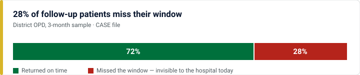
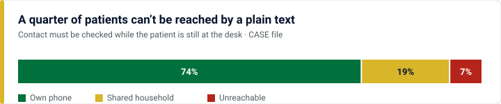
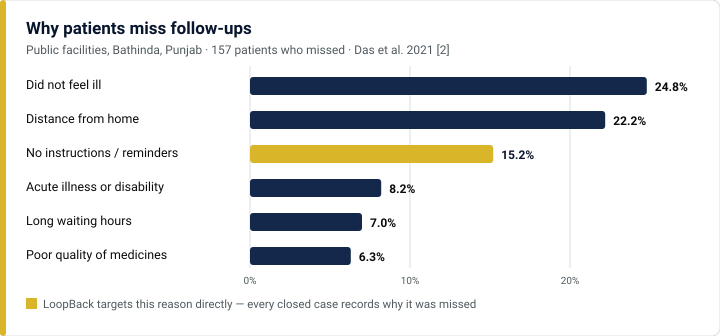
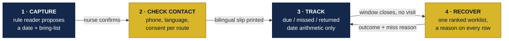
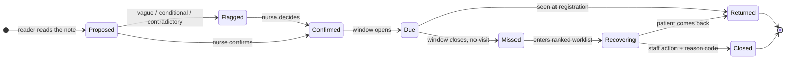
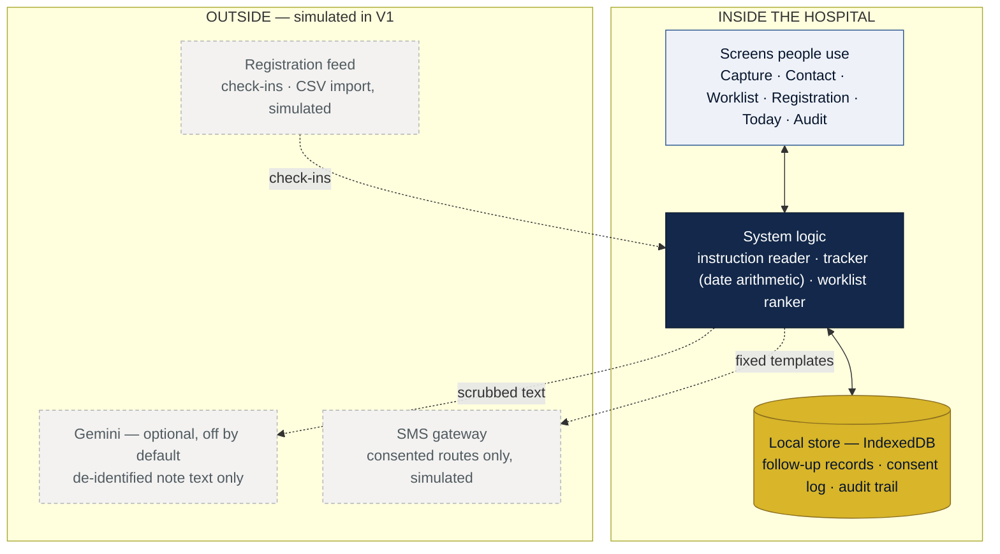
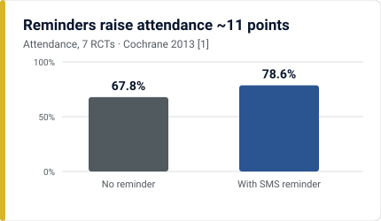

# LoopBack — OPD follow-up register

> Every *“come back”* said in the OPD becomes a **dated, consented follow-up with a named owner** — captured at the desk while the patient is still there.

**AI Synergy Hackathon 2026 · Round 1 · Case 03: Healthcare — “The Follow-Up Blind Spot”**
Team **KitKat** — Pranav · Dhananjay · Sanskar · Saumitra

Built with React · Vite · TypeScript · Vitest. Runs fully offline in the browser.

---

## The problem

When an OPD clinician asks a patient to come back, the request lives only as free text on a slip. The hospital has no record of **who is due, by when, why it matters or how to reach them** — so the 28% who miss their window go unnoticed, and a small records team cannot tell which missed visits to chase first, or how.



Three linked failures sit behind that number:

1. **The request is never captured.** “R/V 2/52 with CBC”, “SOS” and “2 hafte baad” never become a date anyone can track. No system holds a due date, so nobody can see a miss — this is the root cause.
2. **Contact is checked too late.** Shared and unreachable numbers are found only *after* the miss, when the patient has already gone home.
3. **Misses have no owner or order.** Nothing says whom to call first.



Reminders alone don’t fix this. A reminder, a call list or a prediction all need to know **who is due, by when** — and today nobody records that. The evidence also shows missing instructions is a real top-three reason patients miss, but not the only one, so every closed case in LoopBack records **why** it was missed.



The full reasoning, evidence labels, alternatives considered and requirements are in [docs/problem-solution-brief.md](docs/problem-solution-brief.md), and the submission PDFs are in [`submission/`](submission).

---

## What LoopBack does

One record, four steps — **a person confirms every decision**. The system only proposes, flags, counts days and keeps order.



| Step | What happens |
|---|---|
| **Capture** | At the OPD exit desk, a rule reader turns the clinician’s words into a proposed date and a list of things to bring. It understands clinical shorthand (2/52, 6/12), Hinglish and Hindi, ignores medicine courses (“x 14 days”), moves dates to days the clinic actually runs, and **flags anything it cannot read safely**. The nurse confirms — nothing saves until then. |
| **Check contact** | While the patient is still at the desk: the phone number, whether it is shared, the language for texts, and **what they agree to** (texts, calls, caregiver, ASHA visit). They leave with a slip in Hindi and English carrying the clinician’s return precautions word for word. |
| **Track** | Each follow-up gets a window based on the clinician’s importance level. A reminder goes two days before, with consent. Registration records the return. |
| **Recover** | Missed follow-ups go into one list, in an order set by a published points rule, contacted the way the patient agreed. Clinical questions go to a nurse. Nothing is closed without a reason. |

### Who decides what

| | **The system** | **People** |
|---|---|---|
| Does | Proposes dates, flags problems, date arithmetic, orders the list, fills fixed message wording | Confirm every follow-up, set importance, make the calls, answer clinical questions, close cases |

> The system never diagnoses, triages, changes treatment or gives medical advice. Importance is set by the clinician; “returned” is a fact from registration, never a prediction.

---

## How a follow-up moves



A case is only ever resolved automatically by a registration visit; every other closure needs a person and a recorded reason.

---

## Architecture — offline-first at the desk

Identifiers never leave the hospital. The rule reader, tracker and ranker all run in the browser against a local store; the AI second reader and the SMS/registration feeds are optional or simulated in version 1.



**The system never** diagnoses, triages, changes treatment, gives medical advice, contacts anyone without consent, closes a case on its own, or sends patient identifiers to an AI service.

---

## Evidence behind the design

Text reminders are worth sending, but they are only one part of the answer — and they assume the patient has their own phone.



LoopBack makes that gain *possible here* by first creating the record a reminder needs. We claim no improvement figure in advance; the test is whether capture makes the gain reachable. Full citations are in the [brief](docs/problem-solution-brief.md#10-references).

---

## Run it

Needs Node.js 20 or newer.

```bash
npm install
npm run dev        # http://localhost:5173
npm test           # 50 tests: reader, acceptance checks, dataset, UI flows
npm run build      # production build in dist/
```

Everything runs offline in the browser. Demo data lives in your browser’s local storage. Use **Reset** in the grey strip to start again.

### Optional: Gemini cross-check (free tier)

The rule reader works on its own. To add Gemini as a second reader:

1. Get a free API key from Google AI Studio.
2. Copy `.env.example` to `.env.local` and set `GEMINI_API_KEY`. `GEMINI_MODEL` is optional; the default is `gemini-3.5-flash-lite`.
3. Restart `npm run dev`. A **Check with Gemini** button appears on the follow-up desk.

The key stays on the dev server. Only the instruction text is sent, with phone and registration numbers removed. Gemini’s answer is kept only where it quotes the instruction word for word. If it disagrees with the rule reader, the nurse decides. On the free tier Google may use what is sent, so use it with simulated data only.

---

## A five-minute demo

1. **Follow-up desk.** Switch “Viewing as” to *OPD nurse*. Open **Sunita Devi**: “2/52” is highlighted and “x 14 days” is set aside. Choose an importance level, tick what she agrees to, and save to see the slip.
2. Open **Ramesh Kushwaha** (“1 wk / 10 days”). Both dates are offered and nothing is pre-chosen. Also try **Kamla Bai** (SOS), **Arjun Rawat** (“if fever persists”) and **Imran Khan** (“after completing ATT”).
3. **Worklist.** The call queue is ordered by points, and each row says why. Open a patient to see the call script, the privacy-safe text and the history, and record an outcome.
4. Switch to *records staff* and try to close a must-not-miss case. It is refused: only a nurse can.
5. Click **Next week** in the grey strip. Simulated registrations come in, and new misses appear.
6. **Registration.** Search for a patient on the worklist and check them in.
7. **About this prototype.** Read the brief and run the 16 acceptance checks.

---

## Testing & acceptance

`npm test` runs the Vitest suites; the same **16 acceptance checks** also run live on the in-app *About* page. Each can fail. They lock the safety-critical behaviour, for example:

- A vague note (“SOS”) → no date is invented; the record is flagged for a person (AT-02).
- Importance can only be set by a clinician, never the system (AT-06).
- No message names the clinic, test, diagnosis or the clinician’s words (AT-07).
- Reachability changes the **route**, never the **rank** (AT-08).
- A case cannot close without a staff action and a reason code (AT-10).
- Identifiers are removed before any text goes to Gemini (AT-15).

The full list and the requirements each one covers are in the [brief](docs/problem-solution-brief.md#67-acceptance-tests).

---

## Project layout

```
src/core/          Pure TypeScript, no UI. All rules live here and are tested.
  reader.ts          Rule reader for clinicians' instructions
  secondReader.ts    Gemini contract: response schema, identifier scrubbing, grounding check, merge
  policy.ts          Hospital settings: OPD days, grace windows, ranking weights
  tracking.ts        Due, missed and returned (date arithmetic only)
  worklist.ts        Lanes, contact route, points rule
  actions.ts         Every state change, with role and consent rules and an audit entry
  contact.ts         Fixed message templates and call script
  slip.ts            Bilingual patient slip
  metrics.ts         Today page figures and the fairness check
  seed.ts            Simulated dataset (fixed seed)
  acceptance.ts      The 16 acceptance checks (run by the tests and the About page)
src/pages/         Today, Follow-up desk, Worklist, Registration, Audit trail, About
server/            Optional Gemini endpoint, served by the Vite dev server
tests/             Vitest suites
docs/              Problem and solution brief, README charts
submission/        Round 1 submission PDFs
```

---

## Submission package

| Document | File |
|---|---|
| Case Investigation / Problem–Solution Brief | [submission/LoopBack_Case_Investigation_Brief.pdf](submission/LoopBack_Case_Investigation_Brief.pdf) |
| Solution Presentation | [submission/LoopBack_Solution_Presentation.pdf](submission/LoopBack_Solution_Presentation.pdf) |
| Basic SRS / Implementation Plan | [submission/LoopBack_SRS_Implementation_Plan.pdf](submission/LoopBack_SRS_Implementation_Plan.pdf) |

---

## Data and licences

- All patients, phone numbers, places and outcomes are **simulated** from a fixed seed. Proportions follow the case file (28% missed, 19% shared phones, 7% unreachable). They are not real statistics about any hospital.
- Built with React, Vite, TypeScript and Vitest. Optional `@google/genai` for the Gemini cross-check.
- IBM Plex Sans, Plex Sans Devanagari and Plex Mono are bundled locally through Fontsource (SIL Open Font License). There are no web font or CDN calls, so the app works offline.
